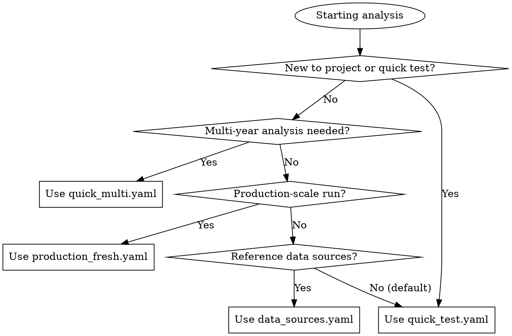

# Ecological Disturbance Attribution System

## Overview

`inducing_factor` discovers **inducing factor combinations** (e.g., "near road + high rainfall + steep slope") that co-occur with ecological disturbances, then attributes each disturbance to dominant factors via Bayesian networks. The workflow: **chunked data pipeline → feature engineering → factor mining → Bayesian attribution → probability maps**.

## When to Use

**Use this skill when:**
- Developing or modifying the inducing_factor project codebase
- Understanding the ecological disturbance attribution workflow
- Configuring data pipelines for multi-source geospatial data
- Implementing feature engineering for static/dynamic/temporal features
- Debugging chunked processing or memory issues
- Working with Bayesian networks (pgmpy) for attribution modeling
- Generating probability maps from model predictions

**When NOT to use:**
- For general geospatial analysis unrelated to disturbance attribution
- When working with unrelated Bayesian network applications
- For simple raster/vector data processing without the attribution context
- When the task only involves data loading without the full attribution pipeline

## Architecture

```
inducing_factor/
├── cli.py                          # CLI entry: run / pipeline / predict-annual-map
├── config/
│   ├── models.py                   # AppConfig dataclasses (PathsConfig, AttributionConfig, etc.)
│   └── loader.py                   # YAML → AppConfig
├── core/
│   ├── attribution_system.py       # EcoDisturbanceAttributionSystem — orchestrator
│   ├── factor_mining.py            # FactorMiner — pattern mining + bootstrap stability
│   ├── discretization.py           # AdaptiveDiscretizer — supervised tree binning
│   ├── bayesian_model.py           # BayesianAttributionEngine — pgmpy or logistic fallback
│   ├── occurrence_model.py         # OccurrenceProbabilityEngine — disturbance probability
│   ├── class_model.py              # DisturbanceClassEngine — fire/logging/geo_hazard/road_construction
│   └── semantics.py                # Human-readable factor names
├── data/loaders/                   # DEM, vector (road/river), climate, landuse, CCDC loaders
├── pipeline/
│   ├── processor.py                # PipelineProcessor — chunked raster → npz cache
│   ├── feature_builder.py          # FeatureBuilder — rainfall windows, rolling history
│   ├── sampling.py                 # StratifiedBackgroundSampler
│   └── probability_mapper.py       # AnnualProbabilityMapper — rasters from predictions
├── io/artifacts.py                 # ArtifactWriter — model persistence
└── utils/
    ├── progress.py                 # ProgressTracker
    └── synthetic.py                # Synthetic test data generator
```

## CLI Commands

| Command | Purpose | Example |
|---|---|---|
| `run` | Full attribution pipeline (streaming) | `python -m inducing_factor.cli run --config configs/production_fresh.yaml` |
| `pipeline` | Chunked raster → npz cache only | `python -m inducing_factor.cli pipeline --config configs/production_fresh.yaml` |
| `predict-annual-map` | Generate probability rasters for a year | `python -m inducing_factor.cli predict-annual-map --config configs/production_fresh.yaml --year 2018` |

## Quick Reference

### Key Configuration Files
| File | Purpose |
|---|---|
| `configs/production_fresh.yaml` | Full-extent production run (4096×4096 chunks) |
| `configs/quick_test.yaml` | Single-year quick test (512×512 chunks) |
| `configs/quick_multi.yaml` | Multi-year limited test (20 chunks max) |
| `configs/data_sources.yaml` | Formal data source definitions |

### Data Directory Structure
```
data/
├── aoi/                    # Area of interest shapefiles
├── dem/                    # Digital elevation model (tibet_dem.tif)
├── landuse/               # Land use rasters (yearly)
├── rainfall/              # Monthly precipitation rasters
├── temperature/           # Annual temperature NetCDF files
├── resident/              # Residential density rasters (yearly)
├── river/                 # River vector data (As_15s_Chimaps.shp)
├── road/                  # Yearly OSM data (2014-2024): roads, railways, waterways
├── ccdc_res/              # CCDC disturbance rasters (yearly)
└── disturbance_class/     # Disturbance classification rasters
```

**Note:** The `road/` directory contains three types of OSM vector data: `roads`, `railways`, and `waterways`. Despite the directory name, it includes all three infrastructure types as separate shapefiles per year (e.g., `osm_2014_roads.shp`, `osm_2014_railways.shp`, `osm_2014_waterways.shp`).

### Common Environment Setup
```bash
# Activate conda environment
source /home/mckay/miniforge3/etc/profile.d/conda.sh
conda activate geo-science

# Install dependencies
pip install -r requirements.txt

# Set PYTHONPATH for local imports
export PYTHONPATH=/mnt/d/inducing_factor:$PYTHONPATH
```

### Configuration Selection Flowchart



**Recommended starting point:** For new users or quick validation, use `configs/quick_test.yaml`.

## Workflow

### Step 1: Data Pipeline (`pipeline` command)

`PipelineProcessor` reads DEM, CCDC, climate, landuse, road/river, resident rasters, clips to AOI, and writes chunked `.npz` files to `cache_dir`. Each chunk contains ~100M rows × 30 columns (point_id, year, static features, monthly rainfall, disturbance info).

### Step 2: Attribution Run (`run` command)

`EcoDisturbanceAttributionSystem.run()` executes `_streaming_run()` in 3 stages:

1. **Stage 1 — Scan & fit discretizer**: Iterate chunks, sample background point_ids at numpy level (memory efficient), build features on sampled subset, collect feature columns, fit `AdaptiveDiscretizer` with supervised tree binning.

2. **Stage 2 — Pattern counts & model samples**: Iterate chunks again, discretize → count event/background patterns, collect training samples for factor stability bootstrap and model fitting.

3. **Stage 3 — Fit models & export**: Mine pattern candidates → estimate stability → reduce redundancy → build factor library → fit Bayesian network + occurrence model + class model → write artifacts.

### Step 3: Probability Maps (`predict-annual-map` command)

`AnnualProbabilityMapper` loads saved artifacts, iterates chunk cache, predicts per-pixel disturbance probability and class probabilities, writes GeoTIFF rasters.

## Key Data Model

### Feature Categories

| Category | Features | Notes |
|---|---|---|
| Static | slope, aspect, dist_to_river | Per point, time-invariant |
| Dynamic (yearly) | dist_to_road, dist_to_railway, dist_to_waterway | Yearly vector data (2014-2024), computed per year |
| Direct | rainfall_prev_1m/2m/3m, rainfall_prev_total_3m | Computed from reference_month |
| Dynamic | temperature, resident | → _prev_last/mean/max via groupby+rolling |
| Categorical temporal | landuse | → _prev_last |
| Excluded from mining | elevation | Broad regional background, not actionable |

**Road data structure:** Yearly OSM data (2014-2024) includes three vector types: `roads`, `railways`, `waterways`. Each produces a distance feature (`dist_to_road`, `dist_to_railway`, `dist_to_waterway`) computed dynamically per year in the pipeline.

### Inducing Factor

Each `InducingFactor` represents a high-co-occurrence pattern (e.g., `dist_to_road=near + rainfall_prev_3m=high`) with:
- `relative_risk`: event support / background support
- `stability`: bootstrap retention rate across resamples
- `score`: support × risk × stability

### Attribution Types

| Type | Condition |
|---|---|
| `single_factor_dominant` | Top factor probability ≥ 0.55 and gap ≥ 0.05 over second |
| `multi_factor_synergy` | Top two factors' combined probability ≥ 0.75 |
| `background_or_unknown` | Neither threshold met |

### Disturbance Classes

1 = fire, 2 = logging, 3 = geo_hazard, 4 = road_construction

## Configuration

YAML config has 4 sections (`paths`, `pipeline`, `attribution`, `data_sources`). Key attribution params:

| Parameter | Default | Purpose |
|---|---|---|
| `background_sample_rate` | 0.05 | Fraction of background point_ids to sample |
| `discretizer_sample_limit` | 200000 | Max rows for discretizer fitting |
| `model_sample_limit` | 200000 | Max rows for model training |
| `max_pattern_size` | 3 | Max items per factor combination |
| `min_support` | 0.05 | Minimum event support for a pattern |
| `min_relative_risk` | 1.5 | Minimum event/background risk ratio |
| `min_stability` | 0.6 | Minimum bootstrap stability |
| `lookback_years` | 3 | Years of history for rolling features |
| `progress_log_every` | 1 | Log progress every N chunks |

## Memory & Performance

- **Chunk sizes**: 100M+ rows each, ~2.9GB on disk. 56 chunks total.
- **Memory strategy**: `_sample_chunk_indices()` samples background point_ids at numpy level before loading into pandas. Only sampled rows (~5%) enter feature engineering.
- **Streaming**: `_streaming_run()` never holds all chunks in memory simultaneously. Sample pools are capped by `discretizer_sample_limit` and `model_sample_limit`.
- **Missing columns**: Chunks lacking certain features (e.g., `resident`) get NaN-filled columns; rows with NaN features are dropped before modeling.

## Testing

```bash
# Safe for agents (synthetic data)
pytest tests/integration/test_synthetic_pipeline.py

# Requires data/ directory access (set environment variable)
RUN_REAL_DATA_TESTS=1 pytest tests/integration/test_loaders_real_data.py

# Recommended: run synthetic tests first to validate core logic
PYTHONPATH=/mnt/d/inducing_factor:$PYTHONPATH python -m pytest tests/integration/test_synthetic_pipeline.py -v
```

## Artifacts Output

After `run`, `out_dir` contains:

| File | Content |
|---|---|
| `model_metadata.json` | Feature columns, selected factor IDs, backend type |
| `inducing_factor_library.json` | Full factor library with stats |
| `discretizer.joblib` | Fitted AdaptiveDiscretizer |
| `bayesian_network.pkl` | Trained BN or fallback model |
| `bayesian_network_edges.json` | DAG edge list |
| `occurrence_probability_model.joblib` | OccurrenceProbabilityEngine |
| `disturbance_class_model.joblib` | DisturbanceClassEngine |
| `training_samples.parquet` | Sampled training data |
| `attribution_preview.parquet` | Sample attribution results |
| `factor_class_summary.parquet` | Factor-class association table |

## Implementation

### Core Components
| Component | File | Purpose |
|---|---|---|
| Pipeline processor | `inducing_factor/pipeline/processor.py` | Chunked raster data processing, yearly distance feature calculation |
| Attribution system | `inducing_factor/core/attribution_system.py` | Streaming attribution workflow, factor mining, model training |
| Feature engineering | `inducing_factor/pipeline/feature_builder.py` | Rainfall windows, rolling history features |
| Bayesian model | `inducing_factor/core/bayesian_model.py` | Bayesian network or logistic regression fallback |
| Data loaders | `inducing_factor/data/loaders/` | DEM, vector, climate, landuse, CCDC loaders |

### Key Implementation Patterns
1. **Chunked processing**: `PipelineProcessor` uses 1024×1024 or 512×512 windows to manage memory
2. **Streaming attribution**: `EcoDisturbanceAttributionSystem._streaming_run()` never loads all chunks simultaneously
3. **Yearly vector data**: Road/railway/waterway distances computed per year using `VectorLoader` instances
4. **Memory efficiency**: Background point sampling at numpy level before pandas conversion
5. **Feature discretization**: `AdaptiveDiscretizer` uses supervised tree binning for optimal splits

### Code Example: Yearly Distance Calculation
```python
# From inducing_factor/pipeline/processor.py
# Dynamic yearly distance calculation for roads, railways, waterways
road_path = os.path.join(self.road_shp_dir, self.road_file_pattern.format(year=year))
if os.path.exists(road_path):
    road_loader = VectorLoader(road_path)
    dist_road = road_loader.get_distance(x_coords, y_coords, dem_crs, max_dist=10000)
else:
    dist_road = np.full(len(x_coords), np.nan)
```

## Common Mistakes

| Mistake | Fix |
|---|---|
| Loading full chunk into pandas | Use `_sample_chunk_indices()` + `_load_chunk_dataframe(npz_path, row_indices=...)` |
| Missing feature columns across chunks | Fill NaN for absent columns before `discretizer.transform()` |
| Using `build_training_samples()` instead of `run()` | `run()` uses streaming; old method loads all chunks into memory |
| Running `test_loaders_real_data.py` without data | Use `test_synthetic_pipeline.py` instead |
| Forgetting to call `load_artifacts()` before prediction | Required when using saved models |
| **Using hardcoded `/Volumes/T9/Datasets/` paths** | **All paths now relative to `data/` directory** |
| **Missing yearly road data configuration** | **Ensure `road_file_pattern`, `railway_file_pattern`, `waterway_file_pattern` are set in config** |
| **Treating `dist_to_road` as static feature** | **Now dynamic (yearly): includes `dist_to_railway`, `dist_to_waterway`** |
| **Not setting PYTHONPATH for local imports** | **`export PYTHONPATH=/mnt/d/inducing_factor:$PYTHONPATH` when running tests** |
